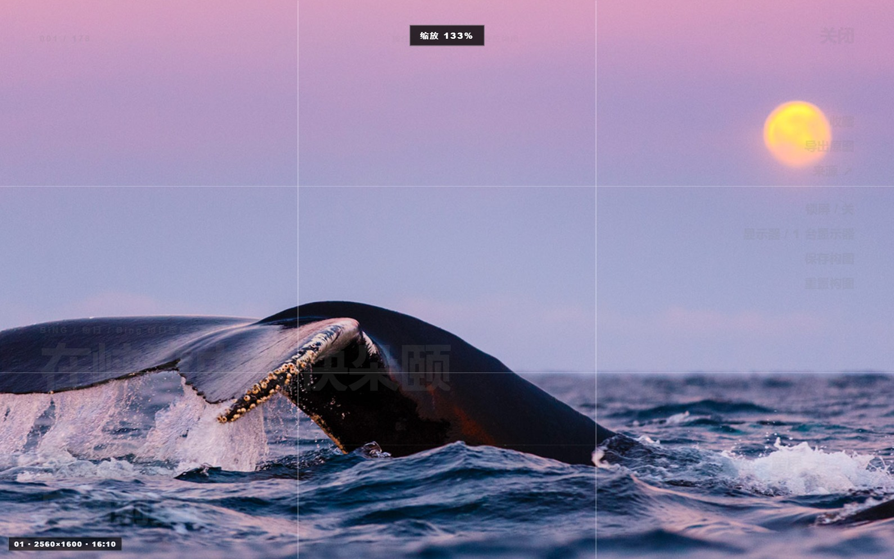
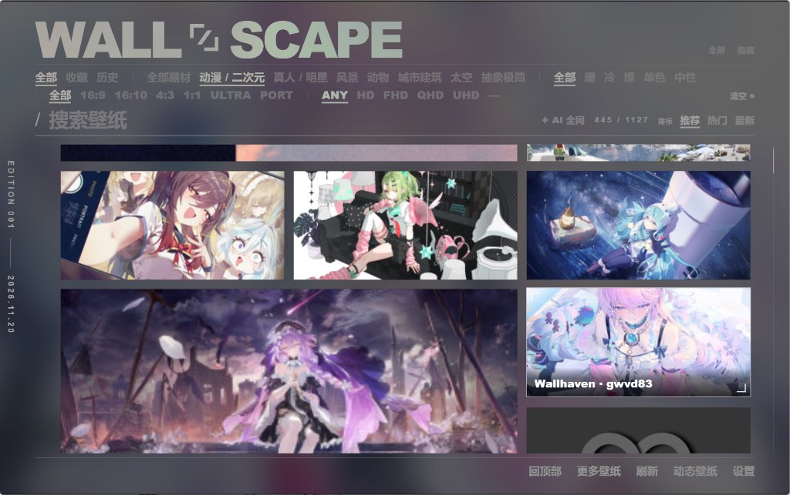

# WALL／SCAPE

面向 Windows 的画报风全屏壁纸浏览、真屏构图与切换工具，零 `npm` 依赖，开箱即用。

> An editorial full-screen wallpaper studio for Windows — adaptive display framing, GPU-accelerated preview zoom, AI-assisted global web search, and live desktop wallpapers with zero npm dependencies.

## 界面预览


| AI 全网多引擎智能搜图（免 Key 聚合） | 真实屏幕 16:10 构图缩放与三分辅助线 |
| :---: | :---: |
|  |  |

| 画报式细节预览与适配模式 | 桌面壁纸自适应毛玻璃画廊 |
| :---: | :---: |
|  |  |

---

## 核心特性

- **真实显示器比例自适应**：自动读取主显示器物理比例与缩放（原生支持 `16:10`、`16:9`、`21:9`、`4:3`、`3:2` 等），窗口与预览舞台严格按真实屏幕比例渲染。
- **所见即所得真屏构图**：详情页即你的真实桌面取景框；基于 GPU 合成（`translate3d + scale`）的 60fps 丝滑缩放与拖拽、三等分构图辅助线、实时缩放 HUD、按住 `Space` 纯净预览、按 `0` 一键复位构图，应用结果与预览像素级一致。
- **AI 全网智能搜图（Beta）**：
  - **免 Key 开箱聚合**：无需配置 API Key 即可聚合检索 **Bing 高清图、百度高清图、Wikimedia Commons、Openverse、Wallhaven**，并内置常用中→英词表与题材隔离。
  - **接入大模型增强**：支持配置 **OpenAI 兼容接口**（OpenAI / DeepSeek / OpenRouter / 本地 Ollama 等）或 **Google Gemini 原生接口**，自动进行意图理解、多语种关键词扩写与相关性重排；另可选配 **Serper（Google Images）** / **Brave Search** 进一步扩展全网图源。
- **多图源与题材精准筛选**：
  - 内置 `WALLHAVEN`（免 Key，自动增量预取与比例/分辨率/分区过滤）、`BING`、`COMMONS`（Wikimedia 精选高分宽屏）、以及可选的 `UNSPLASH`、`PEXELS` 和本地文件夹。
  - 支持题材、色温、宽高比（含原生 `16:10`）、分辨率筛选与前缀联想搜索；动漫与真人题材互斥，且普通题材严格过滤二次元串类。
- **动态壁纸支持**：内置精选动态场景，支持导入本地 `.mp4` / `.webm` 视频并按显示器挂载播放。
- **高性能原生引擎与自动清理**：
  - 常驻 PowerShell + Win32/GDI+ 工作进程，热态读取与构图切换毫秒级响应；支持覆盖 / 拉伸 / 适应 / 平铺 / 居中 / 跨屏模式、撤销与方案保存。在预览页的显示器选择中可单独应用锁屏壁纸。
  - 后台定时清理超过 7 天未使用的磁盘缓存（自动保护当前桌面壁纸、撤销快照与已保存方案）。
- **多语言界面**：内置中文 / English / 日本語一键切换。

---

## 快速开始

### 方式一：下载免安装便携包（推荐普通用户）

1. 前往本仓库的 **[Releases](https://github.com/qianverie/WallSpace/releases)** 页面下载最新版 `Wallscape-portable-*.zip`。
2. 解压到任意目录（无需安装 Node.js 或 npm）。
3. 双击 **`启动.vbs`**（无黑框）或 **`启动.cmd`** 即可启动。

### 方式二：从源码运行（开发者）

1. 克隆仓库：
   ```bash
   git clone https://github.com/qianverie/WallSpace.git
   cd WallSpace
   ```
2. 下载 [Electron v45.2.3 Windows x64 运行时](https://github.com/electron/electron/releases/tag/v45.2.3)（`electron-v45.2.3-win32-x64.zip`），解压至项目根目录下的 `runtime/`，确保存在 `runtime/electron.exe`。
3. 双击 `start.cmd` 启动。

需要桌面和开始菜单入口时，在项目目录运行 `powershell -NoProfile -File .\tools\New-WallspaceShortcuts.ps1`。创建后可从 Windows 菜单将 Wallspace 固定到任务栏。

> `runtime/`、`data/` 和 `cache/` 已写入 `.gitignore`，不会纳入版本控制。本机配置、收藏、历史记录与个人 API 凭据仅保存在本地 `data/state.json`。

---

## 快捷键

### 应用内快捷键

| 按键 | 功能 |
| :--- | :--- |
| `/` | 聚焦搜索框 |
| `↑` / `↓` / `Enter` | 切换并采纳搜索联想 |
| `Esc` | 收起联想 / 关闭详情或设置 / 隐藏窗口 |
| `←` / `→` | 详情页切换上一张 / 下一张 |
| `Space`（长按） | 详情页纯净无 HUD 预览 |
| `0` | 详情页重置构图与缩放 |
| `S` | 收藏 / 取消收藏 |
| `D` | 详情页导出原图 |
| `F` | 切换沉浸全屏 / 窗口模式 |
| `R` | 刷新图源 |
| `C` | 清空全部筛选条件 |
| `Home` | 回到列表顶部 |

### 全局快捷键（后台托盘同样生效）

| 按键 | 功能 |
| :--- | :--- |
| `Ctrl + Alt + W` | 显示 / 隐藏主窗口 |
| `Ctrl + Alt + M` | 切换沉浸全屏 / 窗口模式 |
| `Ctrl + Alt + ←` / `→` | 切换上一张 / 下一张壁纸 |
| `Ctrl + Alt + S` | 收藏当前壁纸 |

---

## AI 全网搜索配置（可选）

打开右下角 **「设置」→「AI 智能全网搜图」**：
- **不填任何 Key**：点击搜索栏右侧 `✦ AI 全网` 即可直接使用免 Key 全网多引擎聚合。
- **使用大模型增强**：选择 `OpenAI 兼容` 或 `Google Gemini`，填入对应的 API Base URL、Model 与 API Key，可点击「测试连接」验证。
- **扩展搜索引擎（可选）**：填入 Serper API Key 或 Brave Search API Key 可接入 Google Images / Brave Images 通道。

---

## 项目结构

```text
wallscape/
├── main.js                # Electron 主进程、窗口自适应、IPC、托盘、缓存回收
├── preload.js             # 安全隔离的渲染层桥接 API
├── core/
│   ├── ai-search.js       # AI 意图扩写（OpenAI / Gemini）与全网多引擎聚合
│   ├── providers.js       # Wallhaven / Bing / Commons / Unsplash / Pexels / 本地目录
│   ├── desktop.js         # 桌面状态、撤销栈、构图合成与缓存保护
│   ├── wallpaper.js       # 常驻 PowerShell 工作进程封装
│   ├── wallpaper.ps1      # Win32 / GDI+ 壁纸设置与锁屏桥接
│   ├── motion.js          # 动态壁纸播放与本地流式服务
│   ├── live-host.ps1      # Windows 桌面底层动态壁纸宿主挂载
│   ├── fetch.js           # 网络请求与下载工具
│   └── store.js           # 本地状态持久化
├── renderer/              # 无框架原生 HTML / CSS / JS 画报界面与真屏构图引擎
├── assets/                # 图标、品牌标识与内置动态壁纸示例
└── start.cmd              # 源码模式启动脚本
```

扩展新图源可在 `core/providers.js` 的 `SOURCES` 中注册：编写将上游返回值映射为 `WallpaperItem` 的加载函数，按需提供独立 `search` 处理函数；需要密钥的图源设置 `needsKey: true` 即可。

---

## 隐私与版权声明

- **本地优先**：所有收藏、历史、构图配置与 API 凭据均仅保存在本机 `data/` 目录，不会向开发者或任何第三方遥测服务器上传个人数据。
- **图片版权**：本工具展示及检索的在线壁纸（含 Wallhaven、Bing、百度、Wikimedia Commons、Openverse、Unsplash、Pexels 及 AI 全网聚合结果）均来自第三方公开网络来源，图片版权归原作者或原平台所有，仅供个人桌面欣赏与学习使用。如需二次分发或商用，请通过详情页「来源 ↗」核对原始授权协议。

---

## License

本项目基于 [MIT License](./LICENSE) 开源。
